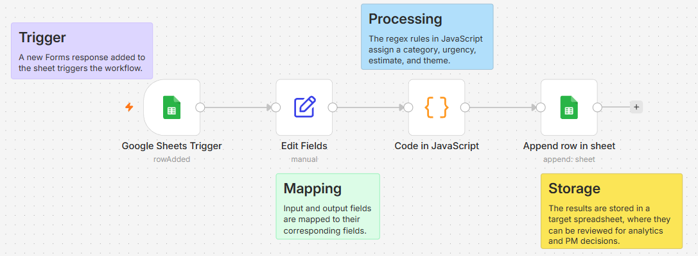
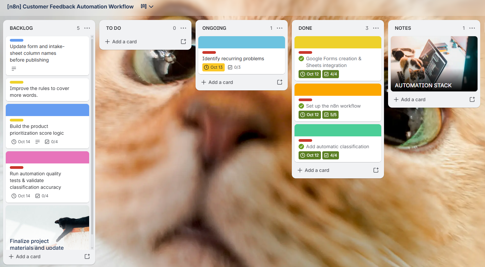
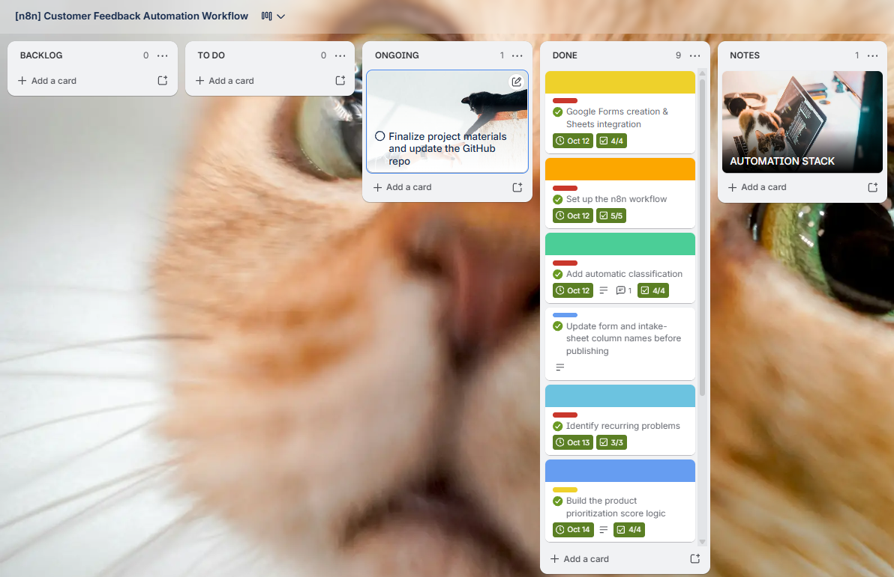
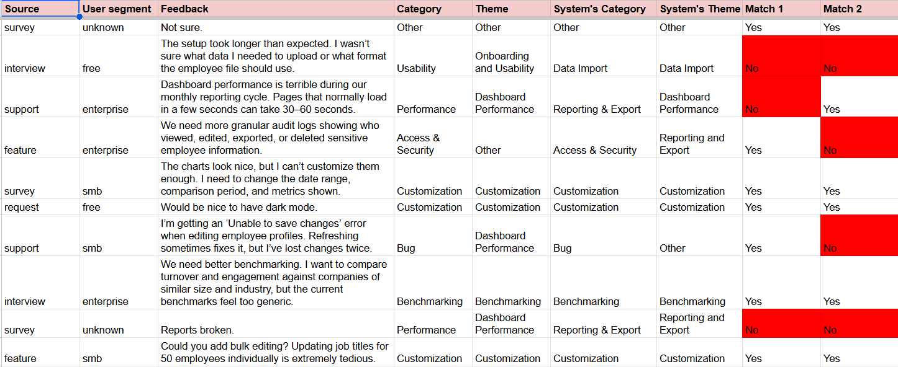

# Product Discovery & Feedback Analytics Automation

---

<h2>The problem</h2>

 

Customer feedback arrives in many forms and describes different issues. This feedback needs to be organized consistently in order to spot recurring problems faster and decide what to prioritize.

I designed a workflow that takes customer feedback from a form, organizes it, and saves the results in a spreadsheet for review.

---

## What the workflow does

<b>1. Collects feedback</b>

 

- It receives submissions through Google Forms.

<b>2. Organizes responses</b>

 

- The workflow uses JavaScript rules to assign a category, urgency, estimate, and theme to the feedback received.

<b>3. Flags uncertain cases</b>

 

- In the case of uncertainty, some of the feedback is marked as "Needs Review" for the product owner/manager to carefully investigate.

<b>4. Stores the results</b>

 

- The results are saved as structured records in Google Sheets.

<b>5. Supports prioritization</b>

 

- The structured results make recurring themes easier to review using metrics such as frequency, impact, strategic fit, and confidence.

---

<h2>Target Audience</h2>

 

This and similar processes can be used by Product Managers and Product Owners or other professionals who regularly deal with incoming feedback.

---

<h2>Tools & Project Management</h2>

 

<h3>Tools used</h3>

 

| Tool | What it does in this project |
|---|---|
| **Google Forms** | Collects feedback |
| **n8n** | Connects and automates the steps |
| **JavaScript rules** | Categorizes feedback and assigns themes |
| **Google Sheets** | Stores and reviews results |

 

<h3>Project Management</h3>

 

Here is the Trello dashboard used to add and track tasks, along with workflow documentation.

---

---

<h2>How prioritization works</h2>

 

This workflow is rule-based and only organizes the evidence. The decision on the roadmap is left to professionals.

The prioritization framework helps explore four questions:

- **Frequency:** How often does this problem appear?
- **Impact:** How much does it affect users?
- **Strategic fit:** Does solving it support product goals?
- **Confidence:** How strong is the evidence?

The scoring weights are working assumptions for this prototype. A Product Manager still reviews the context and makes the decision.

---

<h2>Testing and limitations</h2>

 

I improved the matching rules after identifying gaps. Validation is done through a small set of test examples.

This is a rule-based prototype, not a fully AI-powered or production-ready system. The rules may miss context, misunderstand wording, or assign the wrong theme. Human review remains important.

---

<h2>About this project</h2>

 

This project demonstrates how I approach a product problem, build a practical workflow, improve it through testing, and use structured evidence to support product decisions.

